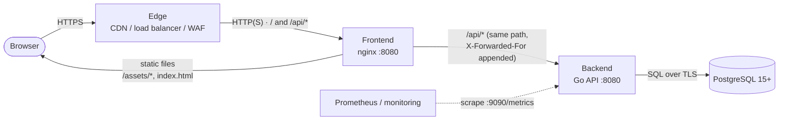
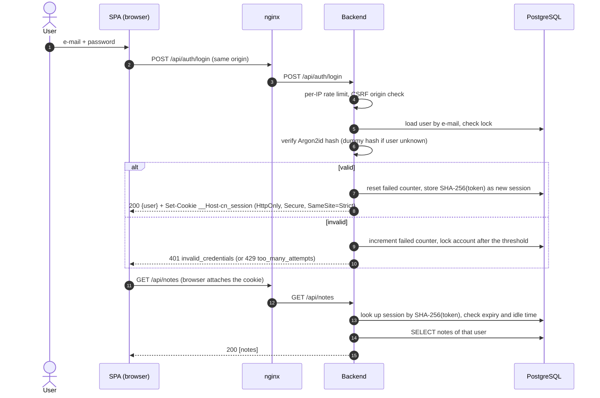
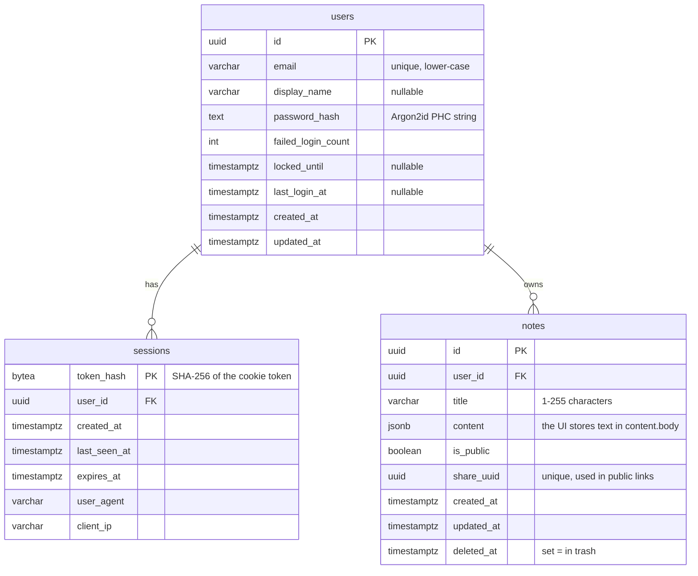
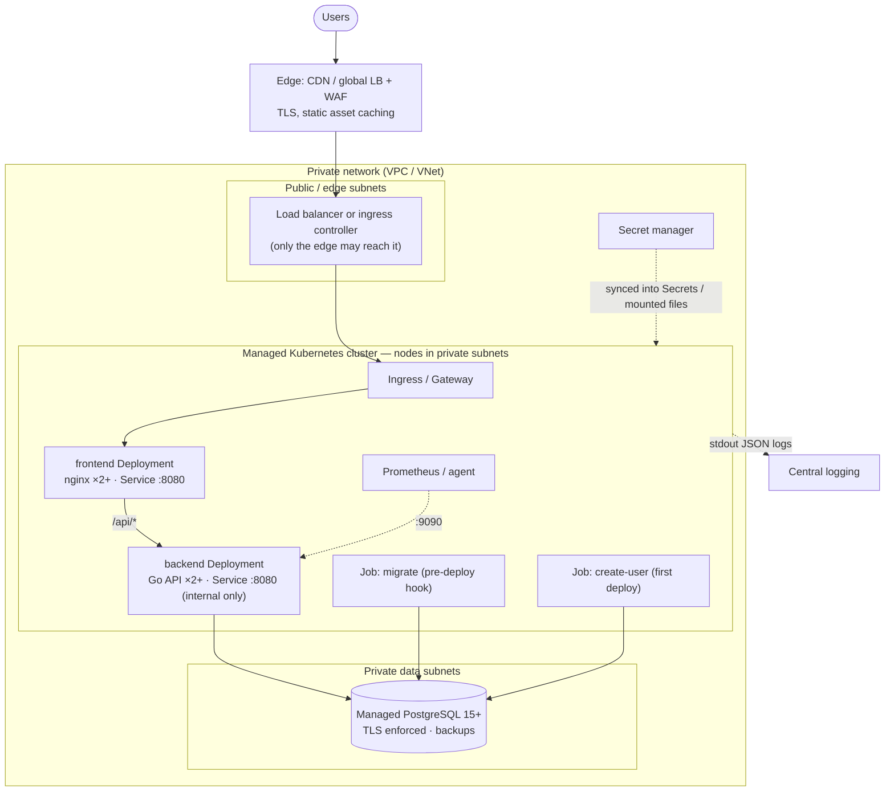
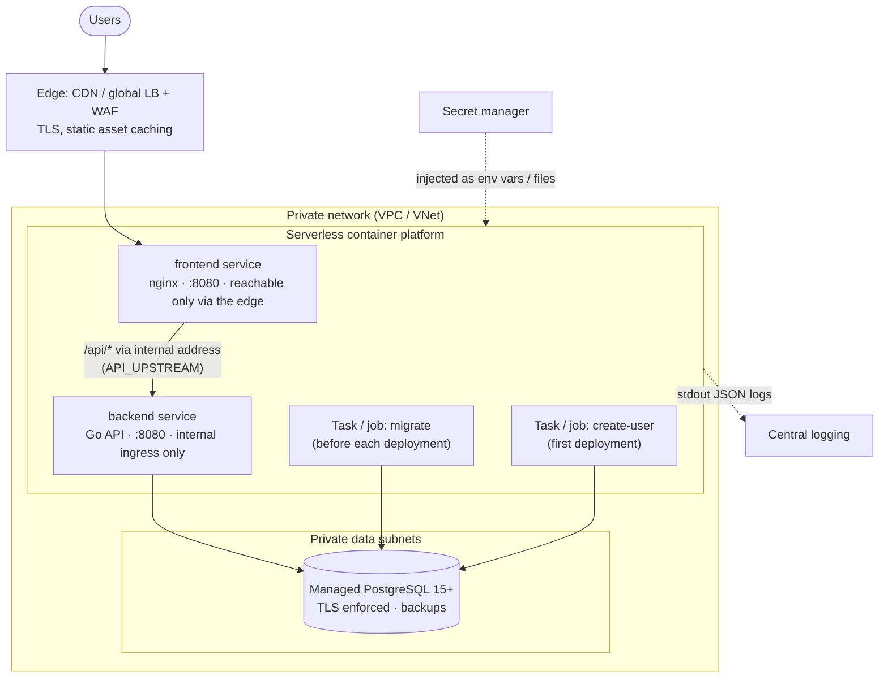

# Architecture

Cloud Notes is deliberately small: two stateless containers and one PostgreSQL database. It has
no cloud SDKs and no cloud identity service, so the same images run on every cloud. Everything
that differs between environments (database, secrets, URLs, feature flags) is configuration —
see [configuration.md](configuration.md).

## Components

| Component | Image | Responsibility |
| --- | --- | --- |
| **Frontend** | `cloud-notes-frontend` (nginx, non-root, port `8080`) | Serves the React single-page application (static files) and reverse-proxies `/api/*` to the backend, so the browser sees **one origin**. Adds security headers, caches `/assets/*`, exposes `/healthz`. |
| **Backend** | `cloud-notes-backend` (Go, distroless, binary `cloud-notes-api`) | JSON API under `/api`: sign-in with e-mail + password, server-side sessions, notes (create, edit, trash, restore, optional public share links). Runs migrations, serves `/healthz` + `/readyz` on `8080` and Prometheus metrics on a separate listener (`9090`). |
| **PostgreSQL** | managed service, version 15+ | The only state: users, sessions, notes. No extensions required. |
| **Edge** | CDN / global load balancer / WAF | TLS termination, caching of static assets, rate limiting of `/api/auth/*`, origin lock-down. Provided by the hosting platform; not part of this repository. |

Design decisions that shape the deployment:

- **Same origin.** The session cookie is `SameSite=Strict`, and there is no CORS support. The SPA and
  `/api/*` must be reachable on the same host name. Either use the frontend container's built-in
  proxy (`API_UPSTREAM`) or route `/api/*` to the backend at your load balancer.
- **Server-side sessions.** The cookie holds a random token; PostgreSQL stores only its SHA-256.
  Any replica can serve any request, and a session can be revoked by deleting a row. No JWTs.
- **Sign-up is closed by default** (`AUTH_SIGNUP_MODE=disabled`). The first user is created by a
  one-off job: `cloud-notes-api create-user`.
- **Stateless containers.** Everything is in PostgreSQL, so both images can be scaled horizontally
  and replaced at will. The only per-replica state is the in-memory login rate limiter
  (best effort, see [security.md](security.md)).

## Request flow

1. The browser requests `https://notes.example.com/…`. The edge terminates TLS and forwards to the
   frontend container.
2. nginx serves the SPA for every path that is not `/api/…` (unknown paths fall back to
   `index.html`, so client-side routing works).
3. `/api/…` requests are proxied unchanged to `API_UPSTREAM`. nginx appends the client address to
   `X-Forwarded-For` and forwards `X-Forwarded-Proto` and `X-Request-ID`.
4. The backend validates the session cookie against PostgreSQL, handles the request and logs one
   JSON line per request (with the request id).
5. Metrics are **not** served on the public listener; the monitoring system scrapes port `9090`.

## Login sequence

JavaScript never sees the token (`HttpOnly`) and the SPA keeps no credentials in `localStorage`.
After a 401 on any protected call the SPA returns to the sign-in page.

## Data model

The schema is created by a single embedded migration (`000001_init`) using core PostgreSQL features
only (`gen_random_uuid()` is built in since PostgreSQL 13), which is why no extensions are needed.
Deleting a note only sets `deleted_at` (trash); there is no automatic purge. Deleting a user
cascades to sessions and notes, but the application has no user-deletion feature.

## Deployment topologies

The application supports two typical production layouts. Both run the same two images and the same
database. These diagrams are provider-neutral; the
[service mapping table](deployment-guide.md#service-mapping) names the concrete services.

### Kubernetes

Typical Kubernetes objects: a Deployment and a Service per image, liveness/readiness/startup probes,
PodDisruptionBudgets, a pre-deploy Job for `migrate` and a one-off Job for `create-user`, and
optionally an Ingress or Gateway API route, a HorizontalPodAutoscaler, NetworkPolicies and a
ServiceMonitor for the metrics port.

### Serverless containers

Trade-offs of this layout: cold starts and minimum instances (the backend keeps a
connection pool and an in-memory rate limiter), scale-to-zero for the frontend versus the
backend, and the maximum number of database connections (`replicas × DB_MAX_CONNS`).
