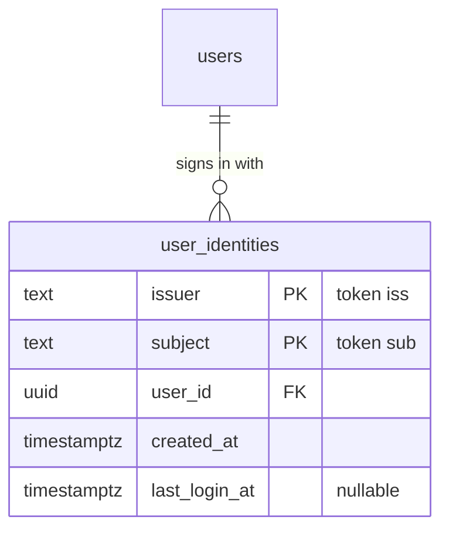

# Authentication

Cloud Notes ships **one pair of container images** that can sign users in in three ways. An
environment variable on the backend, `AUTH_PROVIDER`, selects the identity backend at runtime, so
the same code runs on AWS, Azure and Google Cloud and can use each cloud's managed identity
service. The session after sign-in is always the same: a server-side session in PostgreSQL behind an
`HttpOnly`, `SameSite=Strict` cookie. Notes and everything else do not know how you signed in.

| `AUTH_PROVIDER` | Typical use | How users sign in |
| --- | --- | --- |
| `local` (default) | local development, CI, the smoke test | E-mail and password stored in the application's database (Argon2id). Unchanged since before this feature. |
| `oidc` | **AWS Cognito**, **Azure Entra External ID**, Keycloak (local), Google Sign-In, Auth0, … | The backend is a confidential OpenID Connect client (authorization code flow with PKCE). The browser is redirected to the provider's hosted sign-in page and back. |
| `identity-platform` | **Google Cloud Identity Platform** | The web UI signs in with the Firebase Auth JavaScript SDK (loaded only in this mode) and posts the ID token to `POST /api/auth/session`. |

Why GCP has its own mode: Identity Platform (Firebase Auth's paid tier) has no hosted
authorization endpoint for third-party apps, so there is nothing for an OIDC client to redirect to.
Apps sign in with the client SDK and verify the ID token on the server. That server side is still
plain JWT verification with the same library as the OIDC mode.

## Which cloud uses what

| Cloud | Service | `AUTH_PROVIDER` | Setup |
| --- | --- | --- | --- |
| AWS | Amazon Cognito user pool | `oidc` | [AWS Cognito](#aws-cognito) |
| Azure | Microsoft Entra External ID (external tenant) | `oidc` | [Azure Entra External ID](#azure-entra-external-id) |
| Google Cloud | Identity Platform | `identity-platform` | [GCP Identity Platform](#gcp-identity-platform) |
| Local | Keycloak in Docker Compose | `oidc` | [Local test with Keycloak](#local-test-with-keycloak) |

Azure AD B2C has been closed to new customers since 1 May 2025; use Entra External ID.

> **Who gets an account?** In `oidc` and `identity-platform` mode the application creates an
> account the first time a person signs in, for **anyone the identity provider lets in**
> (`AUTH_SIGNUP_MODE`, `AUTH_INVITE_CODE` and `create-user` do not apply). Control who may sign up
> in the provider: switch off self-service sign-up in the Cognito user pool or the Entra user flow,
> or disable sign-up in Identity Platform, and invite or create users there.

## OIDC mode (AWS Cognito, Azure Entra External ID, Keycloak)

The backend does the OpenID Connect work (the *backend-for-frontend* pattern recommended by the
IETF *OAuth 2.0 for Browser-Based Applications* best current practice). No token ever reaches
JavaScript, and the strict `'self'`-only Content-Security-Policy is unchanged.

```mermaid
sequenceDiagram
    autonumber
    actor U as User
    participant S as SPA (browser)
    participant A as Backend (OIDC client)
    participant P as Identity provider
    participant D as PostgreSQL

    U->>S: click "Sign in with …"
    S->>A: navigate to GET /api/auth/oidc/login?from=/trash
    A->>A: state, nonce, PKCE verifier → __Host-cn_oidc cookie (HttpOnly, SameSite=Lax, 10 min)
    A-->>U: 302 to the provider's authorization endpoint (code_challenge S256)
    U->>P: sign in (hosted page; sign-up, MFA, … happen here)
    P-->>U: 302 to /api/auth/oidc/callback?code=…&state=…
    U->>A: GET /api/auth/oidc/callback (state cookie attached)
    A->>A: per-IP rate limit, compare state in constant time
    A->>P: POST token endpoint (code + PKCE verifier + client secret)
    P-->>A: ID token
    A->>A: verify signature, iss, aud, exp, nonce
    A->>D: find user by (issuer, subject) or create one (no password)
    A->>D: store SHA-256(token) as new session
    A-->>U: 302 to /trash + Set-Cookie __Host-cn_session (HttpOnly, Secure, SameSite=Strict)
    S->>A: GET /api/auth/me (same site, cookie attached)
    A-->>S: 200 {user}
```

Sign-out: `POST /api/auth/logout` revokes the local session as before and, if the provider has a logout
URL, answers `200 {"logout_url": "…"}`. The SPA clears its state and navigates there, so the
provider's own session ends too and the next sign-in asks for credentials again. The logout URL is
`OIDC_LOGOUT_URL` (placeholders `{client_id}` and `{post_logout_redirect_uri}` are URL-encoded and
filled in), or else the `end_session_endpoint` from the discovery document with `client_id` and
`post_logout_redirect_uri` added. Cognito's discovery document has no `end_session_endpoint`, so
`OIDC_LOGOUT_URL` is required there.

Discovery happens on first use and is cached once it succeeds. A provider outage therefore blocks
new sign-ins only: existing sessions and `/readyz` are not affected.

### Backend variables

| Variable | Default | Description |
| --- | --- | --- |
| `AUTH_PROVIDER` | `local` | Set to `oidc`. |
| `OIDC_ISSUER_URL` | — (required) | The provider's issuer, **exactly** as in its discovery document. `https` only. |
| `OIDC_CLIENT_ID` | — (required) | Client ID of the app registration. |
| `OIDC_CLIENT_SECRET` | — (required, secret) | Client secret; `OIDC_CLIENT_SECRET_FILE` works. |
| `PUBLIC_APP_URL` | — (required) | Public origin of the app, e.g. `https://notes.example.com`. |
| `OIDC_REDIRECT_URL` | `PUBLIC_APP_URL` + `API_BASE_PATH` + `/auth/oidc/callback` | Must equal the redirect URI registered at the provider. |
| `OIDC_SCOPES` | `openid email profile` | Must include `openid`. |
| `OIDC_PROVIDER_NAME` | `Single sign-on` | Label of the sign-in button ("Sign in with …"). |
| `OIDC_LOGOUT_URL` | empty | Template with `{client_id}` and `{post_logout_redirect_uri}`. |
| `OIDC_POST_LOGOUT_REDIRECT_URL` | `PUBLIC_APP_URL` + `/login` | Where the provider sends the browser after logout. |
| `OIDC_DISCOVERY_URL` | empty | Development only: fetch discovery from another host name (used by the Docker Compose stack) while tokens are still checked against `OIDC_ISSUER_URL`. |

Issuer, redirect, logout and discovery URLs must use `https`. `http` is accepted only when
`SESSION_COOKIE_SECURE=false`, the existing local-development switch. All other variables are in
[configuration.md](configuration.md).

### AWS Cognito

1. **User pool.** In Amazon Cognito create a user pool (application type *Traditional web
   application*). Choose the sign-in identifier (e-mail) and, under *Self-service sign-up*, decide
   whether visitors may register themselves. Require *email* as an attribute.
2. **Domain.** Under *Branding → Domain* create a Cognito domain (or a custom domain) for the
   managed login pages, e.g. `https://notes-demo.auth.eu-west-1.amazoncognito.com`.
3. **App client.** Create an app client **with a client secret**. Allowed callback URL
   `https://notes.example.com/api/auth/oidc/callback`, allowed sign-out URL
   `https://notes.example.com/login`. OAuth grant type *Authorization code grant*; OpenID Connect
   scopes `openid`, `email`, `profile`. Note the client ID and secret.
4. **Backend settings.**

   ```text
   AUTH_PROVIDER=oidc
   PUBLIC_APP_URL=https://notes.example.com
   OIDC_ISSUER_URL=https://cognito-idp.<region>.amazonaws.com/<user-pool-id>
   OIDC_CLIENT_ID=<app client id>
   OIDC_CLIENT_SECRET=<from Secrets Manager>        # or OIDC_CLIENT_SECRET_FILE
   OIDC_PROVIDER_NAME=Amazon Cognito
   OIDC_LOGOUT_URL=https://<cognito domain>/logout?client_id={client_id}&logout_uri={post_logout_redirect_uri}
   ```

   Cognito's discovery document has no `end_session_endpoint`, hence `OIDC_LOGOUT_URL`. The
   `logout_uri` it receives is `OIDC_POST_LOGOUT_REDIRECT_URL` (`<PUBLIC_APP_URL>/login`), which must
   be in the app client's sign-out URLs.

### Azure Entra External ID

1. **External tenant.** In the Microsoft Entra admin center create an *external* tenant (Entra ID →
   Overview → Manage tenants → Create → External). Note its tenant ID and its
   `<name>.ciamlogin.com` sub-domain.
2. **App registration.** App registrations → New registration. Supported account types: this
   organizational directory only. Platform *Web*, redirect URI
   `https://notes.example.com/api/auth/oidc/callback`; add `https://notes.example.com/login` as a second
   redirect URI (the provider only redirects to registered URIs after logout) and set it as the
   *Front-channel logout URL* too. Under *Certificates & secrets* create a **client secret** and copy
   its value (it is shown once and expires; plan the rotation).
3. **User flow.** External Identities → User flows → New → *Sign up and sign in*. Choose *Email with
   password* (or one-time passcode), collect *Email Address* and *Display Name*, and **add the app
   registration** to the flow. Turn self-service sign-up off in the flow if users should be invited.
4. **E-mail claim.** Token configuration → Add optional claim → token type *ID* → `email`. Without
   it the ID token may carry no e-mail address (the backend then falls back to `preferred_username`
   if that is an e-mail address, otherwise the sign-in ends with `email_claim_missing`).
5. **Backend settings.**

   ```text
   AUTH_PROVIDER=oidc
   PUBLIC_APP_URL=https://notes.example.com
   OIDC_ISSUER_URL=https://<tenant-subdomain>.ciamlogin.com/<tenant-id>/v2.0
   OIDC_CLIENT_ID=<application (client) id>
   OIDC_CLIENT_SECRET=<from Key Vault>              # or OIDC_CLIENT_SECRET_FILE
   OIDC_PROVIDER_NAME=Microsoft
   ```

   The discovery document has an `end_session_endpoint`, so no `OIDC_LOGOUT_URL` is needed.
   Check the issuer with `curl -s "$OIDC_ISSUER_URL/.well-known/openid-configuration" | jq -r .issuer`:
   it must equal `OIDC_ISSUER_URL` character for character (see the troubleshooting table).

### Local test with Keycloak

No cloud account is needed to try the OIDC flow:

```bash
make up-oidc        # builds the images and starts Keycloak 26.4.0 at http://localhost:8081
open http://localhost:3000   # "Sign in with Keycloak": student@example.com / student-local-only-password
make smoke-oidc     # scripted login, notes round trip, logout
```

The realm in `deploy/keycloak/realm-cloud-notes.json` and the credentials in
`docker-compose.oidc.yml` are throw-away values for local development only. If your network cannot
reach `quay.io`, point `KEYCLOAK_IMAGE` at a mirror of the same tag (for example
`KEYCLOAK_IMAGE=keycloak/keycloak:26.4.0 make up-oidc`).

## Identity Platform mode (GCP)

```mermaid
sequenceDiagram
    autonumber
    actor U as User
    participant S as SPA (browser)
    participant F as Firebase Auth SDK (lazy chunk)
    participant G as Identity Platform
    participant A as Backend
    participant D as PostgreSQL

    U->>S: e-mail + password (or "Continue with Google")
    S->>F: dynamic import() on first use, in-memory persistence
    F->>G: sign in (identitytoolkit.googleapis.com)
    G-->>F: ID token (RS256, iss securetoken.google.com/<project>)
    F-->>S: fresh ID token; the SDK signs out right away
    S->>A: POST /api/auth/session {"id_token": …} (same origin, CSRF-checked, rate limited)
    A->>A: verify signature (Google securetoken keys), aud, exp, auth_time ≤ 5 min, tenant, sign-in method
    A->>D: find user by (token iss, sub) or create one (no password)
    A->>D: store SHA-256(token) as new session
    A-->>S: 200 {user} + Set-Cookie __Host-cn_session
```

The Firebase SDK is only a way to obtain the token. Its state is never persisted (in-memory
persistence: nothing in IndexedDB or `localStorage`), and the SDK is signed out right after the
token is handed over, because the application's cookie is the session. `AUTH_PROVIDER=local` and
`oidc` never download any Firebase code: it lives in separate lazy chunks.

### Backend variables

| Variable | Default | Description |
| --- | --- | --- |
| `AUTH_PROVIDER` | `local` | Set to `identity-platform`. |
| `IDP_PROJECT_ID` | — (required) | GCP project ID; the token audience and the issuer suffix. |
| `IDP_API_KEY` | — (required) | Web API key. Public by design: it is sent to the browser. Restrict it (below). |
| `IDP_AUTH_DOMAIN` | — (required) | `<project-id>.firebaseapp.com` (or your custom auth domain). |
| `IDP_TENANT_ID` | empty | Identity Platform tenant; when set, tokens of other tenants are refused. |
| `IDP_SIGN_IN_METHODS` | `password` | Comma-separated subset of `password,google`. Tokens from other methods (anonymous, custom, phone, …) are refused. |

### Frontend container variables

The nginx container renders its security headers at start-up. With the defaults they are exactly the
strict `'self'`-only set, so only this mode needs them:

| Variable | Default | Description |
| --- | --- | --- |
| `FRONTEND_AUTH_PROFILE` | `none` | `none` or `identity-platform`. |
| `IDP_AUTH_DOMAIN` | — | Required with `identity-platform`; a bare host name. Same value as on the backend. |
| `IDP_SIGN_IN_METHODS` | `password` | Exactly `password`, `google`, `password,google` or `google,password`; same as the backend. |

With `identity-platform` the Content-Security-Policy gains `connect-src https://identitytoolkit.googleapis.com
https://securetoken.googleapis.com` and `frame-src https://<IDP_AUTH_DOMAIN>`. When `google` is
enabled it also gains `script-src https://apis.google.com` and `Cross-Origin-Opener-Policy` becomes
`same-origin-allow-popups`, which the Google pop-up needs.

### Setup

1. **Enable Identity Platform** in the Google Cloud console (Identity Platform → Enable; this enables
   the Identity Toolkit API).
2. **Providers.** Add *Email / Password* and, optionally, *Google* (it needs an OAuth client ID and
   secret from APIs & Services → Credentials; the console links the steps). Under *Settings → Password
   policy* require at least 12 characters, like the local mode does. Decide whether users may sign
   up themselves (*Settings → User actions*).
3. **Authorized domains.** Settings → Security → Authorized domains: add the app's domain
   (`notes.example.com`). Sign-in from other domains is refused.
4. **Web API key and auth domain.** Take them from *Application setup details* (the *Web* snippet): `apiKey`
   and `authDomain`. Then restrict the key under APIs & Services → Credentials → the key →
   *Application restrictions: Websites* (`https://notes.example.com/*`) and *API restrictions:
   Identity Toolkit API*. The key is not a secret, but the restriction stops others from using your quota.
5. **Backend settings.**

   ```text
   AUTH_PROVIDER=identity-platform
   IDP_PROJECT_ID=my-project
   IDP_API_KEY=AIza…
   IDP_AUTH_DOMAIN=my-project.firebaseapp.com
   IDP_SIGN_IN_METHODS=password,google
   # IDP_TENANT_ID=tenant-abc123     # only with multi-tenancy
   ```

6. **Frontend container settings.**

   ```text
   FRONTEND_AUTH_PROFILE=identity-platform
   IDP_AUTH_DOMAIN=my-project.firebaseapp.com
   IDP_SIGN_IN_METHODS=password,google
   ```

7. Verify with the checklist below.

### Manual verification checklist (GCP)

Identity Platform needs a real project, so this part is not covered by automated end-to-end tests
(the token verifier and the UI are covered by unit tests with a fake signer and a mocked SDK). The
first instructor or student to deploy on GCP should run it once:

- [ ] `GET /api/config` shows `"auth": {"provider": "identity-platform", "identity_platform": {…}}` with
      your project's values and no secrets.
- [ ] `GET /` response headers include `frame-src https://<auth domain>` and the two Google API hosts in
      `connect-src`; with Google enabled also `script-src … https://apis.google.com` and
      `Cross-Origin-Opener-Policy: same-origin-allow-popups`.
- [ ] Create an account on `/register`. The browser console shows no CSP violations, the request to
      `/api/auth/session` returns `200`, and the notes page opens.
- [ ] `Application → Storage` (IndexedDB, local storage) holds no `firebase:authUser…` entries.
- [ ] Sign out, sign in again with the same password: same account, notes still there.
- [ ] Wrong password shows "Invalid email or password."; the backend log shows no token.
- [ ] "Forgot password?" sends the reset e-mail and shows the neutral confirmation.
- [ ] If Google is enabled: "Continue with Google" opens the pop-up from the authorized domain and
      signs in; closing the pop-up shows no error.
- [ ] Replay protection: copy an ID token from the network tab and `POST` it to `/api/auth/session`
      again after more than 5 minutes; it must answer `401 invalid_token`.
- [ ] An e-mail that is already used by a *different* sign-in method's account answers `409`
      ("This email address is already used by another account.").
- [ ] `POST /api/auth/login` and `POST /api/auth/register` answer `404`.
- [ ] The Web API key is restricted to your domain and the Identity Toolkit API.

## Security decisions

- **Backend-for-frontend.** The browser never holds an access, refresh or ID token in `oidc` mode.
  The session cookie is the same `HttpOnly`, `SameSite=Strict`, `__Host-` cookie as in local mode, and
  the strict CSP stays unchanged. This is the pattern the IETF browser-based-apps BCP ranks highest.
- **Authorization code flow with PKCE (S256), `state` and `nonce`.** All three are checked; the
  authorization request never contains the client secret or the PKCE verifier.
- **The login-state cookie uses `SameSite=Lax`** (`__Host-cn_oidc`, `HttpOnly`, 10 minutes, deleted on
  every outcome of the callback). It has to: the provider's redirect back to the callback is a
  cross-site navigation, which a `Strict` cookie would not survive. The session cookie stays `Strict`;
  it is set on the callback response and used by the next same-site request. The `state` cookie ties the
  browser that started a login to the one that finishes it, which defeats login CSRF.
- **No automatic account linking by e-mail.** External users are keyed on `(issuer, subject)`
  (`user_identities` table). If the e-mail of a new external identity already belongs to another
  account, the sign-in is refused (`account_conflict`) instead of merging. Linking by e-mail would let
  anyone who controls a matching address at some provider take over a local account.
  External users have no password; local password login treats them like unknown users.
- **Unverified e-mail addresses are not accepted.** If the ID token says `email_verified: false`, the
  address is ignored (`email_claim_missing`). Identity Platform password sign-ups are the exception:
  Firebase does not verify the address unless you add a verification step, which this application
  does not have; the account-conflict rule above limits what a made-up address can do.
- **Fresh sign-ins only (Identity Platform).** The token's `auth_time` must be at most 5 minutes old, so
  a captured token cannot be replayed for long; issuer, audience, expiry, tenant and sign-in method
  are checked, and only RS256 tokens signed by Google's securetoken keys pass.
- **In-memory Firebase persistence.** Nothing the SDK knows survives a page reload, and the SDK is
  signed out as soon as the token has been handed over.
- **Nothing sensitive in URLs or logs.** Authorization codes, tokens, the client secret and provider
  error text are never logged or put into a redirect URL. Failed sign-ins redirect to
  `/login?error=` followed by a fixed code, and the log has the stage and a fixed reason
  (`state_mismatch`, `id_token_invalid`, …). The single exception is an issuer mismatch at discovery,
  which logs both issuer URLs because they are public configuration and the usual setup mistake.
- **Open redirects are closed.** The post-login path (`from`) must be a same-site absolute path
  (starts with `/`, not `//` or `/\`, no control characters, at most 2048 bytes) both when it is
  stored and when it is used; anything else becomes `/`.
- **Rate limiting.** `/api/auth/oidc/callback` and `/api/auth/session` use the same per-IP limiter as
  the password endpoints; `/api/auth/session` is also behind the CSRF protection of every mutation.

## Troubleshooting

| Symptom | Likely cause and fix |
| --- | --- |
| Back on `/login?error=oidc_failed`, log `reason=discovery_failed` | The backend cannot reach `OIDC_ISSUER_URL` (network egress, DNS, wrong URL). Existing sessions are unaffected. |
| Same, log has `configured_issuer=… discovered_issuer=…` | **Issuer mismatch.** `OIDC_ISSUER_URL` must equal the discovery document's `issuer` exactly (trailing slash, tenant ID vs. name, `/v2.0`). Fetch `<issuer>/.well-known/openid-configuration` and copy `issuer`. For Entra External ID the sub-domain in the issuer can be the tenant ID rather than the tenant name. |
| `/login?error=email_claim_missing` | The ID token has no usable, verified e-mail. Entra: add the optional `email` claim to the ID token. Cognito: request the `email` scope and make the attribute required. Check that the address is verified at the provider. |
| `/login?error=account_conflict` (or `409` in Identity Platform mode) | A different account already uses this e-mail address (for example a local account, or another provider). Accounts are never merged automatically; use the existing sign-in method or remove the old account. |
| The provider shows "redirect URI mismatch" (or similar) before you ever return | `OIDC_REDIRECT_URL` (default `<PUBLIC_APP_URL>/api/auth/oidc/callback`) is not registered at the provider, or differs in scheme, host, port or path. Register exactly that value. |
| Provider "invalid_client" / back on `oidc_failed`, log `reason=code_exchange_failed` | Wrong client ID or secret, an expired Entra client secret, or a public client (the app client must have a secret). |
| `oidc_failed`, log `reason=state_cookie_missing` | The login state cookie was not sent back: sign-in took more than 10 minutes, cookies are blocked, or the app is reached on a different host name than `PUBLIC_APP_URL`. |
| `oidc_failed`, log `reason=id_token_expired` / Identity Platform `401 invalid_token` | **Clock skew** or a slow client: the server clock is off by more than a few minutes. Run NTP (the cloud time service) on the nodes. |
| Cognito logout stays on the Cognito page or shows an error | `OIDC_LOGOUT_URL` is not set (Cognito has no `end_session_endpoint`), or `<PUBLIC_APP_URL>/login` is not an allowed sign-out URL. |
| Identity Platform: console shows CSP violations, the sign-in does nothing | The frontend container runs with `FRONTEND_AUTH_PROFILE=none` (default), or `IDP_AUTH_DOMAIN`/`IDP_SIGN_IN_METHODS` differ from the project. The container prints the rendered profile at start. |
| Identity Platform: `auth/unauthorized-domain` | The app's host name is not in *Authorized domains*. |
| Identity Platform: the Google pop-up is blocked or closes immediately | `IDP_SIGN_IN_METHODS` on the frontend container does not include `google` (no `script-src`/COOP change), or the browser blocks pop-ups. |
| Backend exits at start with `invalid configuration` | The message lists every problem at once (missing `OIDC_*`/`IDP_*`, `http` URLs without `SESSION_COOKIE_SECURE=false`, …). |
| `404 not_found` on `/api/auth/login` | Expected with `oidc` and `identity-platform`: the password endpoints do not exist in those modes. |

## Data model

Migration `000002_external_identities` makes `users.password_hash` nullable and adds



Each sign-in refreshes the user's e-mail and display name from the token claims (a taken e-mail keeps
the old one and logs a warning). Rolling the migration back is refused while users without a password
exist.
